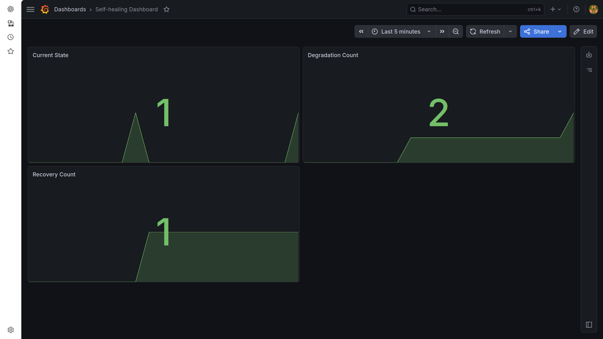
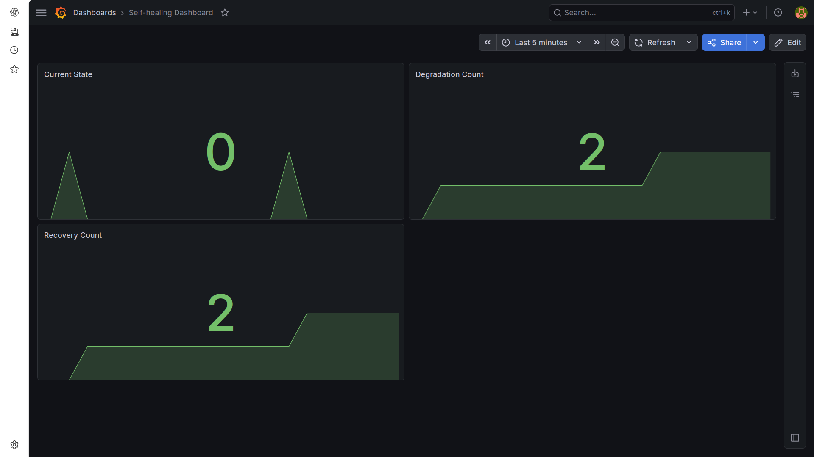
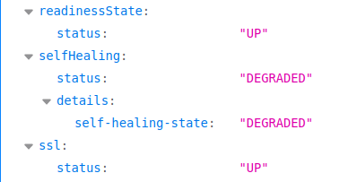
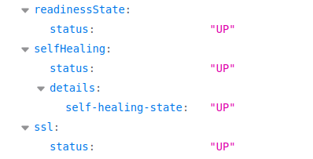
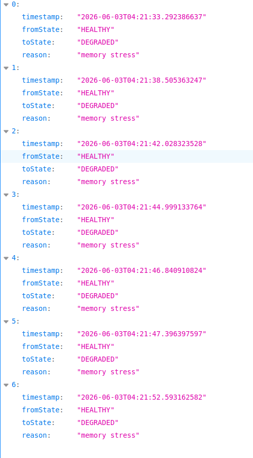
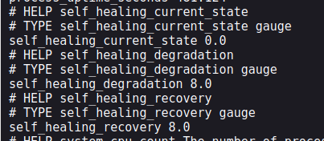
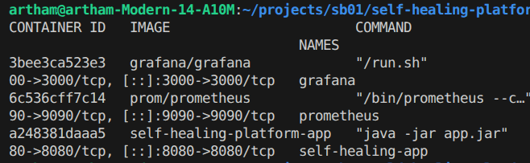
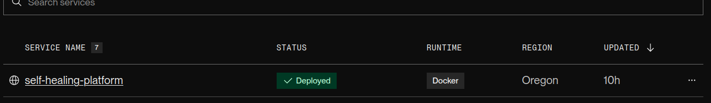

# 🚀 Self-Healing Platform

> A production-ready Spring Boot platform that detects degraded system states, triggers automated recovery workflows, tracks health events, and provides observability through Prometheus and Grafana.

🌐 **Live Demo:** https://self-healing-platform.onrender.com


---

# 🎯 Project Overview

Modern production systems rarely fail instantly. Instead, they gradually degrade due to:

- High CPU utilization
- Memory pressure
- Resource exhaustion
- Slow downstream services
- Infrastructure instability

This project simulates degraded application states, automatically detects unhealthy conditions, triggers recovery workflows, records operational events, and exposes observability metrics through Prometheus and Grafana.

The platform demonstrates how self-healing systems can improve resilience and reduce manual intervention in modern cloud-native applications.

---

# ✨ Key Features

- ✅ Autonomous Health Monitoring
- ✅ CPU Stress Simulation
- ✅ Memory Stress Simulation
- ✅ Automated Recovery Engine
- ✅ Health Event History Tracking
- ✅ Custom Spring Boot Starter
- ✅ Prometheus Metrics Integration
- ✅ Grafana Dashboards
- ✅ Dockerized Monitoring Stack
- ✅ Cloud Deployment on Render
- ✅ Custom Health Indicators
- ✅ Micrometer Metrics Export

---

# 🏗️ Architecture

```text
                    ┌──────────────┐
                    │    Client    │
                    └──────┬───────┘
                           │
                           ▼
                 ┌──────────────────┐
                 │ Spring Boot App  │
                 └──────┬───────────┘
                        │
         ┌──────────────┼──────────────┐
         ▼              ▼              ▼

  Health State    Recovery Engine   Metrics

         ▼              ▼              ▼

     Prometheus ───── Grafana ───── Dashboard
```

---

# 📸 Screenshots

## Grafana Monitoring Dashboard

Real-time visualization of application health, degradation events, and recovery operations.

### Dashboard Overview



### Recovery Monitoring



---

## Health Endpoints

Application health exposed through Spring Boot Actuator and custom health indicators.

### Health Endpoint



### Health Endpoint Details



---

## Health Event History API

Tracks all health state transitions and automated recovery events for auditability and operational diagnostics.



---

## Custom Prometheus Metrics

Custom Micrometer metrics exposed for Prometheus scraping and Grafana visualization.



---

## Dockerized Monitoring Stack

Spring Boot application, Prometheus, and Grafana running together in a containerized environment.



---

## Cloud Deployment

Live deployment hosted on Render.



---

# 🔥 Live Endpoints

### Health Check

```text
https://self-healing-platform.onrender.com/actuator/health
```

### Health History API

```text
https://self-healing-platform.onrender.com/self-healing/history
```

### Prometheus Metrics

```text
https://self-healing-platform.onrender.com/actuator/prometheus
```

### Memory Stress Simulation

```text
https://self-healing-platform.onrender.com/simulate/memory
```

### CPU Stress Simulation

```text
https://self-healing-platform.onrender.com/simulate/cpu
```

---

# ⚙️ How It Works

### 1. Degradation Simulation

The platform can simulate unhealthy application states through:

- Memory pressure generation
- CPU-intensive workloads

### 2. Health Detection

Custom health indicators continuously evaluate system state and update application health.

### 3. Automated Recovery

When degradation is detected:

- System state changes to DEGRADED
- Recovery workflow is triggered
- Metrics are updated
- Recovery events are recorded

### 4. Observability

The platform exposes:

- Health status
- Recovery metrics
- Degradation metrics
- Event history

through Prometheus and Grafana.

---

# 🛠️ Tech Stack

| Layer | Technology |
|---------|------------|
| Language | Java 21 |
| Framework | Spring Boot 3.5 |
| Monitoring | Prometheus |
| Dashboarding | Grafana |
| Metrics | Micrometer |
| Containerization | Docker |
| Deployment | Render |
| Build Tool | Maven |

---

# 📂 Project Structure

```text
self-healing-platform/
│
├── self-healing-starter/
│   ├── health/
│   ├── recovery/
│   ├── metrics/
│   ├── history/
│   └── controller/
│
├── sample-application/
│
├── monitoring/
│   ├── prometheus.yml
│
├── screenshots/
│
├── docker-compose.yml
│
└── README.md
```

---

# 📝 Resume Highlights

- Built a production-ready self-healing platform using Java 21 and Spring Boot 3.5.
- Developed a custom Spring Boot starter enabling health monitoring, degradation detection, and automated recovery workflows.
- Implemented CPU and memory stress simulations to validate resilience mechanisms under degraded conditions.
- Exposed custom Micrometer metrics and integrated Prometheus + Grafana for end-to-end observability.
- Designed health history APIs for tracking state transitions and recovery actions.
- Containerized the complete monitoring stack using Docker.
- Deployed a live cloud-hosted demo on Render.

---

# 🚀 Future Enhancements

## Version 2.0

- Automatic CPU Threshold Monitoring
- Automatic Heap Usage Monitoring
- Pluggable Recovery Strategies
- Email / Slack Alerting
- WebSocket Health Notifications
- Kubernetes Deployment
- Distributed Service Monitoring
- Circuit Breaker Integration
- AI-based Failure Prediction

---

# 🚀 Running Locally

### Clone Repository

```bash
git clone https://github.com/<your-username>/self-healing-platform.git
cd self-healing-platform
```

### Build Project

```bash
mvn clean install
```

### Start Monitoring Stack

```bash
docker compose up --build -d
```

### Access Services

| Service | URL |
|----------|------|
| Application | http://localhost:8080 |
| Prometheus | http://localhost:9090 |
| Grafana | http://localhost:3000 |

---

# 📄 License

MIT License

Feel free to fork, learn from, and extend this project.